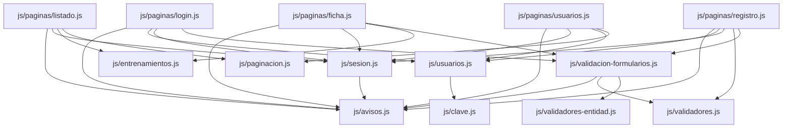

# SportLog · Diario de Entrenamientos


<!-- Completa cada sección a medida que avanzas en los sprints. Borra los comentarios como este
     cuando termines. Este README es también la portada de la documentación que genera `npm run docs`.
     No cambies los títulos de las secciones (##): la corrección los busca por su nombre. -->

## Mi proyecto

SportLog es una aplicación web para deportistas que permite registrar, planificar y analizar entrenamientos y sesiones deportivas individuales, controlando disciplinas, tiempos, ejercicios y marcas personales.
**Web publicada:** <!-- https://<proyecto>.vercel.app -->

### La entidad

La entidad principal de la aplicación es la **sesión de entrenamiento deportivo** (`ficha.html`), aislada por usuario en `localStorage`. Incluye un bloque condicional (*Competición oficial*) y un grupo dinámico de ejercicios (`1` a `5` filas mediante `<template id="plantilla-ejercicio">`):

| Campo | Control | Obligatorio | Regla de validación | Mensaje si no se cumple |
|-------|---------|:-----------:|---------------------|-------------------------|
| Título del entrenamiento | Texto (`input text`) | Sí | Texto no vacío (`required`) | Este campo es obligatorio. |
| Disciplina deportiva | Desplegable (`select`) | Sí | Opción válida (`running`, `trail`, `ciclismo`, `mtb`, `fuerza`, `natacion`, `hiit`, `otro`) | Selecciona una opción válida. |
| Fecha del entrenamiento | Fecha (`input date`) | Sí | Obligatoria y no posterior a hoy (`max` fijado por código) | Este campo es obligatorio. / El valor máximo permitido es `<hoy>`. |
| Duración (horas y minutos) | Número (`input number` × 2) | Sí | Entero total ≥ 1 min (`duracionTotal` entre `0h`–`24h` y `0`–`59` min) | La duración total debe ser de al menos 1 minuto. |
| Distancia (km) | Número (`input number`, `step="any"`) | No | Número ≥ 0 (`min="0"`) | El valor mínimo permitido es 0. |
| Pulso medio (ppm) | Número (`input number`) | No | `data-validar="pulsaciones"` (`REGEX_FRECUENCIA_CARDIACA` + rango lógico `40`–`240` bpm, `min="40"`, `max="230"` en HTML) | La frecuencia cardíaca debe encontrarse en un rango válido entre 40 y 240 bpm. |
| Calorías (kcal) | Número (`input number`) | No | Número ≥ 0 (`min="0"`) | El valor mínimo permitido es 0. |
| Esfuerzo percibido (RPE) | Deslizador (`input range`) | No | Entero entre `1` y `10` (valor por defecto `7`) | El valor mínimo/máximo permitido es 1 / 10. |
| ¿Competición oficial? | Interruptor (`input checkbox role="switch"`) | No | Booleano que habilita/muestra el bloque condicional | — |
| Nombre del evento / carrera *(condicional)* | Texto (`input text`) | Solo si es competición | Obligatorio (`required`), visible y habilitado solo si `esCompeticion` está marcado | Este campo es obligatorio. |
| Dorsal / Posición *(condicional)* | Texto (`input text`) | No *(solo si es competición)* | Opcional; se limpia, oculta y deshabilita (`hidden` + `disabled`) si no es competición | — |
| Bloque de ejercicios (`1`–`5` filas, grupo dinámico) | Texto (`ejercicioNombre[]`) + Texto (`ejercicioDetalle[]`) | Mín. `1` fila, máx. `5` | Nombre obligatorio (`required`); detalle opcional con `data-validar="ejercicioDetalle"` (`REGEX_SERIES_REPETICIONES` + rangos `1`–`50` series, `1`–`200` reps, `0`–`500` kg) | Este campo es obligatorio. / Formato incorrecto. Usa formato Series x Repeticiones (ej: 4x12 o 3x10@80kg). |
| Notas del atleta | Área de texto (`textarea`) | No | Texto libre normalizado con `.trim()` | — |

### El registro de usuarios

| Campo | Control | Regla | Mensaje |
|-------|---------|-------|---------|
| Nombre de usuario | Texto (`input text`) | Alfanumérico y guiones bajos (`[a-zA-Z0-9_]`, 3-15 caracteres), único | El nombre de usuario debe tener entre 3 y 15 caracteres. / Este nombre de usuario ya está ocupado. |
| Correo electrónico | Email (`input email`) | Formato de correo válido | Introduce un correo electrónico válido. |
| Contraseña | Contraseña (`input password`) | Mínimo 8 caracteres, al menos 1 minúscula (`\p{Ll}`), 1 mayúscula (`\p{Lu}`) y 1 cifra (`\d`) | La contraseña debe tener al menos 8 caracteres / incluir al menos una letra minúscula / mayúscula / un número. |
| Repetir contraseña | Contraseña (`input password`) | Debe coincidir con la contraseña (`data-depende-de="clave"`) | Debes repetir la contraseña. / Las contraseñas no coinciden. |
| Acepto términos | Casilla (`input checkbox`) | Obligatorio marcarla | Debes aceptar los términos y condiciones. |


### Páginas

| Página | Acceso | Qué hace |
|--------|--------|----------|
| `index.html` | Pública | Formulario de inicio de sesión. Si ya hay sesión activa, redirige a `listado.html`. |
| `registro.html` | Pública | Registro de nuevos usuarios con comprobador de contraseña. El primer usuario es administrador. |
| `listado.html` | Usuarios | Pantalla principal privada: listado de entrenamientos con KPIs, filtro por disciplina, buscador con *debounce*, paginación y borrado con `<dialog>`. |
| `ficha.html` | Usuarios | Formulario para crear o editar una sesión de entrenamiento deportivo (incluye campo condicional y grupo dinámico de ejercicios). |
| `usuarios.html` | Administradores | Zona de administración exclusiva para buscar, filtrar, paginar usuarios y gestionar sus roles. |

## Arquitectura y módulos

### Diagrama de dependencias entre módulos



### Inventario de módulos

| Módulo | Qué hace | Usa DOM | Exporta |
|--------|----------|:-------:|---------|
| `js/clave.js` | Calcula el hash SHA-256 hexadecimal mediante Web Crypto API (`crypto.subtle.digest`). | No | `resumirClave` |
| `js/avisos.js` | Sistema desacoplado de alertas Bootstrap vía `CustomEvent('aviso')` y persistencia temporal entre páginas. | Sí | `lanzarAviso`, `guardarAvisoParaSiguientePagina`, `iniciarAvisos` |
| `js/usuarios.js` | Persistencia de usuarios en `localStorage`, regla de rol para el primer usuario y verificación de credenciales. | No | `CLAVE_ALMACEN_USUARIOS`, `ROL_ADMINISTRADOR`, `ROL_USUARIO`, `obtenerUsuarios`, `guardarUsuarios`, `buscarUsuarioPorNombre`, `existeUsuario`, `registrarUsuario`, `verificarCredenciales` |
| `js/sesion.js` | Gestión de sesión en `sessionStorage`, guardas de ruta privada/admin y cabecera privada común. | Parcial *(solo en `configurarCabeceraPrivada`)* | `CLAVE_ALMACEN_SESION`, `ROL_ADMINISTRADOR`, `ROL_USUARIO`, `obtenerSesion`, `iniciarSesion`, `cerrarSesion`, `haySesion`, `esAdministrador`, `protegerPaginaPrivada`, `protegerPaginaAdmin`, `configurarCabeceraPrivada` |
| `js/entrenamientos.js` | Operaciones CRUD y persistencia de sesiones deportivas aisladas por usuario en `localStorage`. | No | `PREFIJO_ALMACEN_ENTRENAMIENTOS`, `obtenerClaveEntrenamientos`, `obtenerEntrenamientos`, `guardarEntrenamientos`, `obtenerEntrenamientoPorId`, `obtenerPorId`, `crearEntrenamiento`, `actualizarEntrenamiento`, `borrarEntrenamiento` |
| `js/validadores.js` | Validadores puros para registro (usuario, correo, requisitos de contraseña, repetición y términos). | No | `REGEX_NOMBRE_USUARIO`, `REGEX_CORREO`, `REGEX_MINUSCULA`, `REGEX_MAYUSCULA`, `REGEX_CIFRA`, `validarNombreUsuario`, `validarCorreo`, `comprobarRequisitosClave`, `validarClave`, `validarRepeticionClave`, `validarTerminos` |
| `js/validadores-entidad.js` | Validadores puros con regex y reglas lógicas/fisiológicas para la entidad deportiva. | No | `REGEX_RITMO_CARRERA`, `REGEX_SERIES_REPETICIONES`, `REGEX_FRECUENCIA_CARDIACA`, `validarRitmoCarrera`, `validarSeriesRepeticiones`, `validarFrecuenciaCardiaca`, `validadoresEntidad` |
| `js/paginacion.js` | Función pura `paginar`, sincronización con `?pagina=X`, generación accesible de botones y delegación de clics. | Parcial *(solo renderizado y escucha de controles)* | `ELEMENTOS_POR_PAGINA_DEFECTO`, `paginar`, `obtenerPaginaDeUrl`, `sincronizarPaginaEnUrl`, `reiniciarPaginaEnUrl`, `renderizarControlesPaginacion`, `manejarClickPaginacion` |
| `js/validacion-formularios.js` | Motor compartido de validación en tiempo real (`novalidate`, `blur` en captura, `input`/`change`, `data-validar`, `data-depende-de`, ARIA). | Sí | `validadoresFormulario`, `iniciarValidacionFormulario` |
| `js/paginas/login.js` | Controlador de `index.html`: redirección si hay sesión, validación, login asíncrono y bloqueo anti-doble envío. | Sí | `iniciarLogin` |
| `js/paginas/registro.js` | Controlador de `registro.html`: feedback en vivo de contraseña, unicidad de usuario y alta continua para admins. | Sí | `iniciarRegistro` |
| `js/paginas/listado.js` | Controlador de `listado.html`: KPIs, tarjetas desde `<template>`, buscador con *debounce*, filtro por disciplina, paginación y borrado con `<dialog>`. | Sí | `RETRASO_DEBOUNCE_DEFECTO`, `normalizarTexto`, `formatearDuracion`, `ordenarEntrenamientos`, `filtrarEntrenamientos`, `calcularKpis`, `iniciarListado` |
| `js/paginas/ficha.js` | Controlador de `ficha.html`: alta/edición (`?id=`), duración horas/min, campo condicional, grupo dinámico (1–5) y `FormData`. | Sí | `MIN_EJERCICIOS`, `MAX_EJERCICIOS`, `iniciarFicha` |
| `js/paginas/usuarios.js` | Controlador de `usuarios.html`: guarda de admin, buscador, filtro por rol, paginación y cambio de rol con `<dialog>`. | Sí | `RETRASO_BUSQUEDA_DEFECTO`, `normalizarTexto`, `filtrarUsuarios`, `iniciarUsuarios` |

### Objetos y patrones de diseño

Los datos de dominio (`usuario`, `sesion`, `entrenamiento`) son objetos planos serializables a JSON creados mediante **funciones fábrica / constructores funcionales** (`registrarUsuario`, `crearEntrenamiento`, `actualizarEntrenamiento`, `paginar`) que normalizan campos y añaden metadatos (`id` con `crypto.randomUUID()`, `creadoEn`, `modificadoEn`), evitando clases innecesarias y facilitando su persistencia en `Storage`.

Patrones de diseño empleados:
1. **Publicador–Suscriptor (*Observer* desacoplado) en `js/avisos.js`:** cualquier controlador o el motor de validación dispara `lanzarAviso(elemento, mensaje, tipo)` emitiendo un `CustomEvent('aviso', { bubbles: true })` sin conocer la estructura del contenedor visual; un único oyente registrado en `document` mediante `iniciarAvisos` renderiza la alerta en `#contenedor-avisos`.
2. **Estrategia (*Strategy*) en `js/validacion-formularios.js` y `js/validadores-entidad.js`:** los validadores comparten la firma `(valor, campo, formulario) => { valido, error? }` y se agrupan en el mapa `validadoresFormulario` (que extiende `validadoresEntidad`). El motor selecciona dinámicamente la estrategia leyendo `campo.dataset.validar`, sin condicionales específicos por campo en el núcleo.
3. **Inyección de dependencias en datos y controladores:** todas las funciones de acceso a datos (`usuarios.js`, `sesion.js`, `entrenamientos.js`) y de inicialización de página (`iniciarLogin`, `iniciarRegistro`, `iniciarListado`, `iniciarFicha`, `iniciarUsuarios`) reciben sus dependencias por parámetro con valores por defecto del navegador.

### Cómo reciben las páginas lo que necesitan y por qué se pueden probar

Cada controlador `iniciar*` acepta un objeto de configuración opcional (`{ documento, almacenUsuarios, almacenSesion, almacenEntrenamientos, navegar, ubicacion, historia, ... }`) que toma por defecto los objetos globales del navegador (`document`, `localStorage`, `sessionStorage`, `location.replace`, `window.location`, `window.history`).

Gracias a este desacoplamiento, los tests pueden sustituir los almacenes reales por instancias aisladas de `tests/AlmacenFalso.js`, las redirecciones por espías `vi.fn()` y la ubicación/historial por objetos simulados sin modificar `window` ni contaminar pruebas paralelas.

### Documentación JSDoc

Todos los módulos en `js/` incluyen comentarios JSDoc con `@module`, descripciones funcionales y etiquetas `@param` y `@returns` para parámetros, opciones inyectadas y estructuras devueltas. La documentación HTML estática se genera en `docs/` a partir de `jsdoc.json` y de este `README.md` ejecutando:

```bash
npm run docs
```

## Cómo ejecutarlo

### Abrir el proyecto y ver la web

1. Abre la carpeta del repositorio en VS Code y ejecuta **Dev Containers: Reopen in Container** (`.devcontainer/` configura Node.js 24, instala dependencias con `npm install` y arranca `serve` en el puerto `3901`).
2. Abre la aplicación en `http://localhost:3901` (al usar ES Modules, debe servirse siempre por HTTP; `serve.json` conserva parámetros de consulta como `ficha.html?id=...`).

### Comandos disponibles en el contenedor

- **Pruebas unitarias:** `npm test` (ejecuta Vitest con `happy-dom`, excluyendo `e2e/`).
- **Linter (ESLint):** `npm run lint`.
- **Comprobación de formato (Prettier):** `npm run format:check` (o `npm run format` para formatear).
- **Documentación JSDoc:** `npm run docs` (genera `docs/`).
- **Compilación para publicación:** `npm run build` (ejecuta `scripts/construir.js` y copia la web y el CSS de Bootstrap a `dist/`).

*(Los comandos `npm run coverage` con umbral de cobertura y `npm run e2e` con las pruebas completas de Playwright quedan pendientes de las tareas `S2-09` y `S2-10`).*

## Almacenamiento y sesión

### Claves utilizadas

| Clave | Almacén | Qué guarda | Ejemplo de contenido |
|-------|---------|------------|----------------------|
| `sportlog_usuarios` | `localStorage` | Lista JSON de deportistas registrados (la contraseña nunca se guarda en claro, solo su hash SHA-256). | `[{"nombreUsuario":"christian","correo":"c@ejemplo.es","clave":"ba7816bf...","rol":"administrador","creadoEn":"2026-11-10T18:00:00.000Z"}]` |
| `sportlog_entrenamientos_<usuario>` | `localStorage` | Array JSON de sesiones deportivas propias de `<usuario>` (en minúsculas), con `id` UUID v4. | `[{"id":"550e8400-e29b-41d4-a716-446655440000","titulo":"Rodaje 10K","disciplina":"running","fecha":"2026-11-12","duracion":50,"esCompeticion":false,"ejercicios":[{"nombre":"Calentamiento","detalle":"1x10"}]}]` |
| `sportlog_sesion` | `sessionStorage` | Objeto JSON con el usuario autenticado y su rol en la pestaña actual. | `{"nombreUsuario":"christian","rol":"administrador"}` |
| `sportlog_aviso_pendiente` | `sessionStorage` | Aviso temporal que se consume y muestra tras redirigir de una página a otra. | `{"mensaje":"¡Bienvenido de nuevo, christian!","tipo":"success"}` |

Todas las lecturas (`obtenerUsuarios`, `obtenerSesion`, `obtenerEntrenamientos`, `iniciarAvisos`) envuelven `JSON.parse` en bloques `try/catch` y validan tipos (`Array.isArray`, presencia de `nombreUsuario` y `rol`), devolviendo `[]` o `null` si los datos almacenados están corruptos.

### Por qué cada dato va donde va

- **`localStorage` (`sportlog_usuarios`, `sportlog_entrenamientos_<usuario>`):** persiste al cerrar la pestaña o el navegador, necesario para conservar las cuentas registradas y el historial deportivo de cada atleta entre sesiones. Además, usar una clave por usuario (`obtenerClaveEntrenamientos`) garantiza el aislamiento de datos entre deportistas en el mismo navegador.
- **`sessionStorage` (`sportlog_sesion`, `sportlog_aviso_pendiente`):** está acotado a la pestaña activa y se destruye al cerrarla, evitando que una sesión abierta quede permanente al cerrar el navegador y permitiendo transportar mensajes de confirmación entre redirecciones (`location.replace`) sin contaminar otras pestañas.

### Roles y protección de páginas

- El primer usuario registrado en un almacenamiento vacío recibe `rol: 'administrador'` y los siguientes `rol: 'usuario'` (`registrarUsuario` en `js/usuarios.js`). Ese rol se copia en `sportlog_sesion` al iniciar sesión.
- **Páginas públicas (`index.html`):** `iniciarLogin` comprueba `haySesion()` y, si ya existe sesión, redirige directamente a `listado.html`.
- **Páginas privadas (`listado.html`, `ficha.html`):** llaman a `protegerPaginaPrivada()`, que redirige a `index.html` mediante `location.replace` si no hay sesión (evitando que el botón «Atrás» devuelva a la página privada).
- **Zona de administración (`usuarios.html`):** llama a `protegerPaginaAdmin()`, que envía a `index.html` si no hay sesión, o guarda un aviso `danger` y redirige a `listado.html` si el rol no es `'administrador'`. Además, `configurarCabeceraPrivada` mantiene oculto `#menu-usuarios` (`hidden`) para usuarios estándar, y `js/paginas/usuarios.js` impide que un administrador se quite su propio rol o deje menos de un administrador.

### Por qué este inicio de sesión NO es seguro

Al no existir servidor ni backend, tanto la lista de usuarios como la sesión residen en el navegador del cliente. Aunque `resumirClave` calcula un resumen SHA-256 para no guardar la contraseña en texto plano:
1. Cualquiera con acceso a las **DevTools → Application** puede editar `sessionStorage` (`sportlog_sesion`), inventarse una sesión o cambiar `"rol": "usuario"` a `"rol": "administrador"` para acceder a `usuarios.html`.
2. También puede leer o alterar `localStorage` (`sportlog_usuarios` o los entrenamientos de cualquier usuario), e incluso sustituir el hash SHA-256 de otro usuario por uno conocido.
3. En una aplicación real, la autenticación y autorización se validan en un servidor: las contraseñas se almacenan con algoritmos lentos con *salt* (`bcrypt`, `Argon2id`), la sesión se gestiona mediante cookies `HttpOnly` / `Secure` / `SameSite` firmadas (o tokens verificados en cada petición) y las comprobaciones de rol y propiedad de los datos se aplican siempre en el servidor.

## Funcionalidad y formularios

### Sesión y registro (`index.html`, `registro.html`)

- **Registro (`js/paginas/registro.js`):** valida formato y disponibilidad del nombre de usuario (`existeUsuario`), correo, fortaleza de contraseña con feedback visual en tiempo real (`#req-longitud`, `#req-minuscula`, `#req-mayuscula`, `#req-cifra`), coincidencia con la repetición y aceptación de términos. Si se registra un usuario sin sesión previa, inicia sesión automáticamente y redirige a `listado.html` con un aviso pendiente; si quien da de alta es un administrador con sesión activa, conserva su sesión y vuelve a `usuarios.html`.
- **Inicio de sesión (`js/paginas/login.js`):** permite acceder por nombre de usuario o correo (`verificarCredenciales`). Si falla, emite aviso `danger`, vacía `#clave` y le devuelve el foco. Tanto login como registro usan una bandera `enviando` y deshabilitan el botón de envío mientras `await resumirClave(...)` se resuelve para impedir envíos concurrentes.

### Listado y paginación (`listado.html`, `js/paginas/listado.js`, `js/paginacion.js`)

- Calcula KPIs globales (`calcularKpis`), genera píldoras dinámicas de filtro por disciplina con contadores y ordena del entrenamiento más reciente al más antiguo (`ordenarEntrenamientos`).
- Clona `#plantilla-entrenamiento` rellenando exclusivamente con `textContent`, atributos (`href="ficha.html?id=..."`, `dataset.id`, `aria-label`) y `replaceChildren` sobre un `DocumentFragment` para insertar el listado de una sola vez sin `innerHTML`.
- El buscador aplica *debounce* (`250 ms`), normaliza con `NFD` para ignorar mayúsculas y tildes (`normalizarTexto`) y reinicia a la página 1.
- La paginación usa la función pura `paginar(lista, pagina, porPagina)` (6 elementos por página por defecto), corrige páginas fuera de rango, genera botones accesibles (`disabled` en extremos, `aria-current="page"`) y sincroniza `?pagina=X` con `URLSearchParams` y `history.replaceState`.
- El borrado abre el `<dialog id="dialogo-borrar">` nativo (`showModal()` / `close()`) antes de ejecutar `borrarEntrenamiento`.

### Ficha de entrenamiento (`ficha.html`, `js/paginas/ficha.js`)

- **Modo alta / edición:** lee `?id=` mediante `URLSearchParams`. En edición rellena todos los controles (incluido el deslizador RPE y las filas de ejercicios guardadas); si el `id` no existe, guarda aviso de error y redirige a `listado.html`.
- **Atributos por código:** calcula `hoy` en ISO (`YYYY-MM-DD`) y asigna `campoFecha.max = hoy`.
- **Duración:** sincroniza `#duracion-horas` y `#duracion-minutos` en tiempo real hacia `#duracion` (minutos totales).
- **Campo condicional:** la casilla `#es-competicion` alterna `bloqueCondicional.hidden` y `disabled` en `#nombre-competicion` y `#dorsal`; cuando se desactiva, vacía sus valores y limpia su estado de validación para que no se envíen ni validen ocultos.
- **Grupo dinámico de ejercicios (`1` a `5`):** clona `<template id="plantilla-ejercicio">`, numera de forma única `ejercicio-nombre-<n>` y `ejercicio-detalle-<n>` asignando `label.htmlFor`, `id` de la caja de error y `aria-describedby`. Deshabilita los botones de quitar cuando hay `1` fila (`MIN_EJERCICIOS`) y el de añadir al llegar a `5` (`MAX_EJERCICIOS`).
- **Lectura con `FormData`:** extrae campos simples con `formData.get(...)` y las filas dinámicas con `formData.getAll('ejercicioNombre[]')` y `formData.getAll('ejercicioDetalle[]')`, normalizando cadenas con `.trim()` y tipos numéricos antes de guardar.

### Zona de administración (`usuarios.html`, `js/paginas/usuarios.js`)

- Protegida por `protegerPaginaAdmin`. Renderiza la tabla desde `<template id="plantilla-fila-usuario">`, con buscador con *debounce* (nombre o correo sin tildes), filtro por rol (`todos`, `administrador`, `usuario`) y paginación compartida de `js/paginacion.js`.
- El botón de cambio de rol abre `<dialog id="dialogo-confirmar-rol">` y aplica el cambio en `localStorage` (`aplicarCambioRol`), garantizando que el administrador activo tiene su propio botón desactivado (`disabled`) con mensaje explicativo enlazado por `aria-describedby` y que nunca pueda quedar `0` administradores.

### Validación en tiempo real (`js/validacion-formularios.js`)

- **Cuándo:** cada campo se valida por primera vez al salir de él (`blur` en fase de captura en el `<form>`). Una vez tocado o marcado como inválido, se revalida en cada `input` y `change`. Los campos dependientes (`data-depende-de="clave"` en repetir contraseña, o `duracion-horas` → `duracion-minutos`) se revalidan automáticamente cuando cambia el campo del que dependen.
- **Cómo y accesibilidad:** los tres formularios llevan `novalidate`. El motor lee el atributo `data-validar` para aplicar validadores personalizados mediante `setCustomValidity()` y combina el resultado con `ValidityState` (`valueMissing`, `typeMismatch`, `rangeUnderflow`, `rangeOverflow`, etc.). Actualiza la clase Bootstrap `is-invalid`, muestra el mensaje en `.invalid-feedback` (`d-block`) enlazada con `aria-describedby` y marca `aria-invalid="true" | "false"`. Al enviar con errores, emite aviso `danger` y mueve el foco al primer campo inválido.
- **Anti-doble envío:** tanto `login.js` como `registro.js` bloquean nuevos envíos (`if (enviando) return;`) y desactivan el botón `submit` mientras dura la operación asíncrona de `resumirClave`.

### Expresiones regulares

| Expresión regular | Validador / módulo | Ejemplo válido | Partes y *flags* | Qué hace la regex vs. el código |
|-------------------|--------------------|----------------|------------------|--------------------------------|
| `/^[a-zA-Z0-9_]{3,15}$/` | `validarNombreUsuario` (`js/validadores.js`) | `atleta_2026` | `^...$` ancla inicio/fin; `[a-zA-Z0-9_]` letras ASCII, dígitos y `_`; `{3,15}` longitud. Sin *flags*. | La regex valida caracteres permitidos y longitud `3–15`; el código comprueba tipo, `.trim()`, longitud previa y unicidad (`existeUsuario`). |
| `/^[^\s@]+@[^\s@]+\.[^\s@]+$/` | `validarCorreo` (`js/validadores.js`) | `ana@sportlog.es` | `[^\s@]+` parte local sin espacios ni `@`; `@`; dominio con al menos un punto `.` y TLD. Sin *flags*. | La regex exige estructura `local@dominio.tld`; el código realiza `.trim()` y comprueba que no sea vacío. |
| `/\p{Ll}/u` | `comprobarRequisitosClave` (`js/validadores.js`) | `a` o `ñ` | `\p{Ll}` categoría Unicode de letra minúscula; *flag* `u` (Unicode). | Detecta cualquier minúscula Unicode (incluidas `ñ`, `á`); el código combina los 4 requisitos (`length >= 8`, minúscula, mayúscula, cifra). |
| `/\p{Lu}/u` | `comprobarRequisitosClave` (`js/validadores.js`) | `A` o `Ñ` | `\p{Lu}` categoría Unicode de letra mayúscula; *flag* `u` (Unicode). | Detecta cualquier mayúscula Unicode (incluidas `Ñ`, `Á`); el código evalúa el cumplimiento conjunto en `validarClave`. |
| `/\d/` | `comprobarRequisitosClave` (`js/validadores.js`) | `7` | `\d` dígito decimal (`0–9`). Sin *flags*. | Verifica presencia de al menos una cifra; el código exige longitud mínima de `8` caracteres. |
| `/^(\d{1,2}):(\d{2})$/` | `validarRitmoCarrera` (`js/validadores-entidad.js`) | `04:15` | `(\d{1,2})` captura 1–2 dígitos de minutos; `:` literal; `(\d{2})` captura 2 dígitos de segundos. Sin *flags*. | La regex valida la sintaxis `m:ss` o `mm:ss` y extrae los grupos; el código comprueba que `segundos < 60` y que el ritmo esté en límites fisiológicos (`120` a `900` s/km, es decir `2:00`–`15:00` min/km). |
| `/^(\d{1,2})\s*[xX*]\s*(\d{1,3})(?:\s*@\s*(\d+(?:\.\d+)?)\s*(?:kg)?)?$/i` | `validarSeriesRepeticiones` (`js/validadores-entidad.js`) | `4x12@80.5kg` | `(\d{1,2})` series; `[xX*]` separador con espacios opcionales; `(\d{1,3})` repeticiones; grupo opcional `(?:@\s*(\d+(?:\.\d+)?)\s*(?:kg)?)?` para carga decimal. *Flag* `i` (insensible a mayúsculas). | La regex valida la estructura y extrae series, repeticiones y carga; el código verifica los rangos numéricos: series `1–50`, repeticiones `1–200` y carga `0–500` kg. |
| `/^(\d{2,3})(?:\s*(?:bpm|ppm))?$/i` | `validarFrecuenciaCardiaca` (`js/validadores-entidad.js`) | `165 ppm` | `(\d{2,3})` captura 2–3 dígitos; grupo opcional para unidad `bpm` o `ppm`. *Flag* `i`. | La regex acepta número con unidad opcional y extrae las pulsaciones; el código valida el rango cardiológico `40 <= bpm <= 240`. |

## Eventos

### Eventos en el HTML

- **Envío con `Intro`:** al estructurar los formularios con `<form>` y `<button type="submit">`, el navegador dispara nativamente el evento `submit` al pulsar `Intro` dentro de cualquier campo de texto sin escribir oyentes `keydown` adicionales.
- **Atributos de validación + `novalidate`:** los formularios incluyen `novalidate` (reforzado con `formulario.noValidate = true`) junto a atributos semánticos (`required`, `type="email"`, `type="date"`, `type="number"`, `min`, `max`, `step`), de modo que el navegador calcula `ValidityState` automáticamente sin mostrar sus globos nativos, dejando el renderizado accesible a nuestro código.
- **Diálogos nativos (`<dialog>`):** `#dialogo-borrar` y `#dialogo-confirmar-rol` aprovechan la semántica modal del navegador (`showModal()`, cierre con `Esc`, foco atrapado).
- **Accesibilidad con `label for`:** pulsar cualquier `<label for="...">` enfoca su control o alterna casillas e interruptores (`#terminos`, `#es-competicion`) sin JavaScript extra.
- **Sin atributos `on…`:** no se utiliza ningún manejador inline (`onclick`, `onsubmit`, etc.) en el HTML, manteniendo separadas las tres capas (estructura, presentación y comportamiento).

### Tipos de eventos

| Evento | Por qué se elige frente a alternativas parecidas |
|--------|-------------------------------------------------|
| `submit` (vs. `click` en el botón) | Captura tanto el clic en el botón como el envío con la tecla `Intro` desde cualquier campo del formulario, permitiendo cancelar la recarga con `evento.preventDefault()`. |
| `input` (vs. `change` en campos de texto y buscadores) | Se dispara inmediatamente con cada pulsación o pegado, necesario para el feedback en vivo de contraseña, el cálculo de duración, la etiqueta RPE, el *debounce* del buscador y la revalidación tras el primer error. |
| `change` (vs. `input` en checkbox y select) | Garantiza la reacción tras confirmar la selección en `<select>` o conmutar `#es-competicion`. |
| `blur` en captura (vs. `focusout` en burbuja) | `blur` no burbujea; escucharlo en captura permite un único oyente en `<form>` equivalente al comportamiento por campo sin depender de `focusout` y cubriendo campos dinámicos. |
| `aviso` (`CustomEvent` con `bubbles: true`) | Desacopla el origen del mensaje del contenedor visual `#contenedor-avisos`: cualquier componente lanza el evento y sube hasta el único oyente en `document`. |
| `DOMContentLoaded` (vs. `load`) | Inicializa los controladores en cuanto el DOM está parseado sin esperar a hojas de estilo o recursos externos. |

### Propagación

#### Tabla de oyentes registrados

| Evento | Dónde se registra | Fase | Para qué |
|--------|-------------------|------|----------|
| `aviso` | `document` (`js/avisos.js`) | Burbuja | Escucha cualquier `CustomEvent('aviso')` que suba desde formularios o listados y renderiza la alerta Bootstrap en `#contenedor-avisos`. |
| `click` | `.btn-close` de cada alerta (`js/avisos.js`) | Objetivo / burbuja | Elimina la alerta del DOM al cerrarla manualmente. |
| `click` | `#btn-cerrar-sesion` (`js/sesion.js`) | Objetivo / burbuja | Cierra la sesión, guarda aviso pendiente y navega a `index.html`. |
| `click` | Contenedor `<ul>` de paginación (`js/paginacion.js`) | Burbuja (delegado) | Detecta pulsaciones en `.btn-pagina` (`closest`) para cambiar de página. |
| `blur` | `<form>` en los 3 formularios (`js/validacion-formularios.js`) | **Captura (`true`)** | Valida cada campo por primera vez al salir de él (incluidos los campos dinámicos). |
| `input` | `<form>` en los 3 formularios (`js/validacion-formularios.js`) | Burbuja (delegado) | Revalida en tiempo real los campos ya tocados o inválidos y sus dependientes. |
| `change` | `<form>` en los 3 formularios (`js/validacion-formularios.js`) | Burbuja (delegado) | Revalida selects y checkboxes ya tocados o inválidos y sus dependientes. |
| `submit` | `#formulario-login` (`js/paginas/login.js`) | Objetivo / burbuja | Valida, evita doble envío, verifica credenciales con SHA-256 e inicia sesión. |
| `input` | `#clave` (`js/paginas/registro.js`) | Objetivo / burbuja | Actualiza en vivo los 4 indicadores visuales de requisitos de contraseña. |
| `submit` | `#formulario-registro` (`js/paginas/registro.js`) | Objetivo / burbuja | Valida, evita doble envío, registra al usuario y redirige según rol. |
| `DOMContentLoaded` | `document` (`registro.js`, `listado.js`, `ficha.js`, `usuarios.js`) | Objetivo | Arranca cada controlador cuando `document.readyState === 'loading'`. |
| `input` | `#duracion-horas` y `#duracion-minutos` (`js/paginas/ficha.js`) | Objetivo / burbuja | Recalcula en directo el total de minutos en `#duracion` y su texto informativo. |
| `change` | `#es-competicion` (`js/paginas/ficha.js`) | Objetivo / burbuja | Muestra/oculta y habilita/deshabilita los campos condicionales de competición. |
| `input` | `#esfuerzo-rpe` (`js/paginas/ficha.js`) | Objetivo / burbuja | Actualiza la etiqueta descriptiva del nivel de esfuerzo RPE. |
| `click` | `#contenedor-ejercicios` (`js/paginas/ficha.js`) | Burbuja (delegado) | Elimina la fila de ejercicio pulsada (`closest('.boton-quitar-ejercicio')`) respetando el mínimo de 1. |
| `click` | `#btn-anadir-ejercicio` (`js/paginas/ficha.js`) | Objetivo / burbuja | Añade una nueva fila de ejercicio desde `<template>` respetando el máximo de 5. |
| `submit` | `#formulario-ficha` (`js/paginas/ficha.js`) | Objetivo / burbuja | Valida, lee `FormData` (`get` y `getAll`), crea o actualiza el entrenamiento y vuelve al listado. |
| `input` | `#campo-buscar` (`js/paginas/listado.js`) | Objetivo / burbuja | Lanza la búsqueda filtrada con *debounce* (250 ms) y reinicia a página 1. |
| `click` | `#filtros-disciplinas` (`js/paginas/listado.js`) | Burbuja (delegado) | Filtra por disciplina al pulsar cualquier `.pill-filtro` generada dinámicamente. |
| `click` | `#contenedor-entrenamientos` (`js/paginas/listado.js`) | Burbuja (delegado) | Detecta pulsación en `.boton-borrar` (`closest`) y abre `#dialogo-borrar` con el `id` de la tarjeta. |
| `click` | `#btn-cancelar-borrado` y `#btn-confirmar-borrado` (`js/paginas/listado.js`) | Objetivo / burbuja | Cancela o confirma la eliminación del entrenamiento y re-renderiza el listado. |
| `input` | `#campo-buscar-usuarios` (`js/paginas/usuarios.js`) | Objetivo / burbuja | Filtra usuarios por nombre o correo con *debounce* (250 ms) y reinicia a página 1. |
| `click` | `#filtros-rol-usuarios` (`js/paginas/usuarios.js`) | Burbuja (delegado) | Cambia el filtro activo por rol mediante `closest('.pill-filtro')`. |
| `click` | `#cuerpo-tabla-usuarios` (`js/paginas/usuarios.js`) | Burbuja (delegado) | Detecta clics en `.boton-accion-rol` de cada fila y abre `#dialogo-confirmar-rol`. |
| `click` | `#btn-confirmar-rol` y `#btn-cancelar-rol` (`js/paginas/usuarios.js`) | Objetivo / burbuja | Confirma o cancela el cambio de rol de usuario y re-renderiza la tabla. |

#### Delegación de eventos

Se utiliza delegación en fase de burbuja con `evento.target.closest(...)` en todos los contenedores cuyo contenido se crea o reemplaza dinámicamente:
- **Paginación** (`#lista-paginacion` y `#lista-paginacion-usuarios` en `js/paginacion.js`),
- **Listado de tarjetas** (`#contenedor-entrenamientos` y `#filtros-disciplinas` en `js/paginas/listado.js`),
- **Grupo dinámico de ejercicios** (`#contenedor-ejercicios` en `js/paginas/ficha.js`),
- **Tabla y filtros de administración** (`#cuerpo-tabla-usuarios` y `#filtros-rol-usuarios` en `js/paginas/usuarios.js`),
- **Validación en `input`/`change`** sobre el propio `<form>` (`js/validacion-formularios.js`).

Con ello se evita registrar oyentes por cada elemento clonado, se reducen los recursos en memoria y los elementos creados con posterioridad (como nuevas filas de ejercicios o nuevas páginas renderizadas tras filtrar) funcionan automáticamente sin volver a enlazar manejadores.

#### Uso de la fase de captura

En `js/validacion-formularios.js`, `formulario.addEventListener('blur', manejarBlur, true)` registra el oyente en **fase de captura** porque el evento `blur` **no burbujea** en el DOM. Si se registrara en fase de burbuja (`false`), el `<form>` nunca recibiría el evento cuando el usuario sale de un `<input>`, `<select>` o `<textarea>`. Escucharlo en captura permite centralizar la primera validación en el formulario y cubrir automáticamente los campos dinámicos que se añaden después en `ficha.html`.

#### Uso de `stopPropagation`

No se utiliza `stopPropagation()` en ningún módulo: la delegación mediante `closest(...)` y la comprobación explícita del elemento origen garantizan que cada oyente actúe solo cuando el clic o cambio procede del selector esperado, sin interferir con el burbujeo normal de eventos (como el evento propio `aviso`).

## Pruebas y cobertura

<!-- 1. Tabla de la pirámide: tipo (unitario, de integración o de extremo a extremo), fichero,
        qué prueba y cuántos tests tiene. Por qué cada cosa se prueba en ese nivel y no en otro.
     2. Cómo simulas al usuario (eventos, requestSubmit), los servicios (AlmacenFalso, el resumen
        de la contraseña, la navegación) y el tiempo (temporizadores falsos).
     3. Cómo se ejecutan las mismas pruebas de extremo a extremo con serve y contra la web
        desplegada (BASE_URL).
     4. Pega la salida de `npm run coverage` (con el resumen de la cobertura) y de `npm run e2e`.
        Explica qué umbral has puesto, a qué ficheros y qué queda sin probar y por qué. -->

## Integración continua

### ESLint y Prettier

Para asegurar la máxima calidad de código, coherencia de estilo y prevención temprana de defectos, se han añadido tres reglas adicionales a la configuración plana de `eslint.config.js`:

1. **`camelcase` (`'error'`):**
   - **Qué comprueba:** Obliga a que todos los identificadores de variables, funciones y propiedades sigan la convención `camelCase` estándar de JavaScript.
   - **Por qué la queremos:** Evita mezclas de convenciones (`snake_case` o `PascalCase` inadecuados) y mantiene una nomenclatura homogénea y profesional en todo el repositorio.

2. **`curly` (`'error'`):**
   - **Qué comprueba:** Exige el uso explícito de llaves `{ ... }` en todas las estructuras de control (`if`, `else`, `for`, `while`), prohibiendo sentencias condicionales de una sola línea sin llaves.
   - **Por qué la queremos:** Previene errores de lógica graves provocados por añadir sentencias posteriores pensando que forman parte del bloque condicional cuando en realidad quedan fuera.

3. **`no-console` (`['error', { allow: ['warn', 'error'] }]`):**
   - **Qué comprueba:** Prohíbe el uso de `console.log` en el código fuente de la aplicación, permitiendo únicamente `console.warn` y `console.error` para situaciones anómalas justificadas. Además, se define una excepción en la configuración para ficheros de utilidades de construcción (`scripts/**/*.js`).
   - **Por qué la queremos:** Asegura que no queden llamadas residuales de depuración en producción que ensucien la consola del navegador del usuario o expongan información interna.

#### Salida de verificación de ESLint (`npm run lint`):
```text
> mi-aplicacion@1.0.0 lint
> eslint .
```

#### Salida de comprobación de estilo con Prettier (`npm run format:check`):
```text
> mi-aplicacion@1.0.0 format:check
> prettier --check .

Checking formatting...
All matched files use Prettier code style!
```

#### Problema real identificado y resuelto con el depurador de las DevTools:
Durante la implementación de la autenticación asíncrona con la Web Crypto API (`crypto.subtle.digest`), al probar el envío del formulario con el teclado (pulsaciones rápidas de `Enter`), descubrimos en la pestaña **Sources** y **Event Listener Breakpoints** de las DevTools que el evento `submit` se disparaba repetidamente antes de completarse el hashing de la contraseña. Esto provocaba ejecuciones concurrentes de `verificarCredenciales` e intentos de doble inserción en el almacenamiento.  
**Solución aplicada:** Se introdujo una bandera de control de estado en el ciclo de vida del formulario (`let enviando = false;`) y la desactivación inmediata del botón (`botonLogin.disabled = true;`), ignorando cualquier envío concurrente hasta que la promesa criptográfica se resuelva.

### El workflow

El flujo de integración continua está configurado en `.github/workflows/ci.yml`. Se ejecuta automáticamente ante cada `push` y en cada `pull_request` dirigido a la rama `main`, garantizando que ningún código roto o con estilo no conforme entre en el tronco principal. Cuenta con permisos restringidos de solo lectura (`permissions: contents: read`).

| Trabajo | Espera a | Pasos | Artefacto |
|---------|----------|-------|-----------|
| `Calidad` | — | 1. Checkout del repositorio (`actions/checkout@v4`).<br>2. Configuración de Node.js 24 con caché npm (`actions/setup-node@v4`).<br>3. Instalación limpia (`npm ci`).<br>4. Verificación de reglas de ESLint (`npm run lint`).<br>5. Verificación de formateo con Prettier (`npm run format:check`). | — |
| `Tests` | `Calidad` | 1. Checkout del código.<br>2. Configuración de Node.js 24 y caché npm.<br>3. Instalación de dependencias (`npm ci`).<br>4. Ejecución de suite de pruebas unitarias e integración con Vitest (`npm test`). | — *(Sprint 2)* |
| `E2E` *(Sprint 2)* | `Tests` | Pruebas de extremo a extremo con Playwright. | `playwright-report/` *(si falla)* |

**¿Por qué están en este orden?**  
El trabajo de `Calidad` es muy rápido y descarta errores sintácticos, variables no utilizadas o incoherencias de estilo en segundos. El trabajo de `Tests` requiere más tiempo y cómputo; al depender de `Calidad` mediante `needs: Calidad`, nos aseguramos de no malgastar minutos de Actions ejecutando pruebas si el código ya contiene fallos básicos de estilo o reglas estáticas incumplidas.

## Despliegue continuo

<!-- Sprint 3. 1. Cómo has configurado Vercel: build, carpeta de salida, protección de los
        despliegues y Deployment Checks (qué comprobaciones exige y por qué).
     2. Qué hacen despliegue.yml y release.yml, y qué comprueba tu prueba de humo.
     3. El camino de un cambio, con tus palabras: desde tu git push en una rama hasta que se ve en
        la web, qué se comprueba en cada paso y qué pasa si algo falla. -->

**Web publicada:** <!-- https://<proyecto>.vercel.app -->

| Evidencia | Enlace | Captura |
|-----------|--------|---------|
| *Pull request* con su vista previa y `E2E desplegado` | <!-- enlace a la pull request --> | `img/pr-comprobaciones.png` |
| Versión retenida por Vercel | <!-- enlace a la ejecución en rojo --> | `img/vercel-retenido.png` |
| Release `v1.0` | <!-- enlace a la Release --> | — |

<!-- Qué rompiste a propósito para la versión retenida, qué viste en Vercel y cómo comprobaste que la
     web seguía con la versión anterior. -->

## Organización del trabajo

### Definición de Hecho

Para dar una tarea por terminada en el tablero y poder fusionar su rama a main:
- [x] El código pasa `npm run lint` y `npm run format:check` sin avisos ni errores.
- [x] La funcionalidad está probada con tests de Vitest y todos pasan en verde (`npm test`).
- [x] No se utilizan librerías de terceros en JavaScript ni APIs remotas.
- [x] Se comprueba la seguridad de sesión y los permisos de usuario/administrador.
- [x] La Pull Request en GitHub tiene el workflow de integración continua en verde.

### Sprints

| Sprint | *Tag* | Qué incluye | Reflexión |
|--------|-------|-------------|-----------|
| 1 | `v0.1` | Gestión de usuarios en `localStorage`, roles (`administrador` para el primer usuario), resumen SHA-256 (`js/clave.js`), control de sesión en `sessionStorage`, avisos por `CustomEvent`, formularios de registro y login con validaciones en tiempo real y anti-doble envío, suite de 74 tests unitarios y workflow de CI (Calidad + Tests). | La modularización en ES Modules con inyección de dependencias (`AlmacenFalso`) ha permitido alcanzar más de un 90% de cobertura sin tocar el navegador. Fue clave entender el asincronismo de la Web Crypto API y resolver las condiciones de carrera con banderas de estado en el formulario. Para el Sprint 2 planificaremos con mayor antelación el modelado de la entidad y la paginación. |
| 2 | `v0.2` | El CRUD y la zona de administración, con todas sus pruebas y la integración continua completa. | *(Pendiente)* |
| 3 | `v1.0` | Despliegue en producción con Vercel, pruebas de extremo a extremo con Playwright y entrega final. | *(Pendiente)* |

**Tablero de Trello:**
https://trello.com/invite/b/6aec9ce9063c16b7c0047ea8/ATTI178831c6a60f25f26ec0e00a2054500d26E02A60/dwec-sportlog

**Blog del proyecto:** [blog/README.md](blog/README.md)

### Ramas y versiones

Cada funcionalidad se desarrolla en una rama independiente y se integra en `main` exclusivamente mediante **Pull Request con Merge Commit**. Se utiliza merge commit en lugar de rebase o squash porque preserva la historia fidedigna del proyecto, vincula cada cambio con su revisión en GitHub y asocia los informes de ejecución de GitHub Actions a cada commit de integración de forma inmutable.

El archivo `.gitignore` excluye `node_modules/`, `dist/`, `docs/`, `coverage/`, `playwright-report/`, `test-results/` y archivos propios del sistema operativo (`.DS_Store`, `Thumbs.db`), ya que son dependencias instalables o artefactos compilados/generados automáticamente que no deben contaminar el control de versiones.

| Rama | Funcionalidad | *Pull request* |
|------|---------------|----------------|
| `sprint-1-documentacion` | Documentación inicial, entidad y tablas | [#1](https://github.com/fpftoro-docencia/dwec-2dawt-2627-proyectodomeval-ccruper0503/pull/1) |
| `sprint-1-maquetacion` | Maquetación base de las 5 páginas y estilos Dark Pro | [#2](https://github.com/fpftoro-docencia/dwec-2dawt-2627-proyectodomeval-ccruper0503/pull/2) |
| `sprint-1-avisos` | Módulo desacoplado de avisos con CustomEvent | [#3](https://github.com/fpftoro-docencia/dwec-2dawt-2627-proyectodomeval-ccruper0503/pull/3) |
| `sprint-1-usuarios` | Módulo de usuarios, roles, hash SHA-256 y resiliencia | [#4](https://github.com/fpftoro-docencia/dwec-2dawt-2627-proyectodomeval-ccruper0503/pull/4) |
| `sprint-1-registro` | Formulario de Registro interactivo y feedback en vivo | [#5](https://github.com/fpftoro-docencia/dwec-2dawt-2627-proyectodomeval-ccruper0503/pull/5) |
| `sprint-1-login` | Formulario de Login, redirecciones y anti-doble envío | [#6](https://github.com/fpftoro-docencia/dwec-2dawt-2627-proyectodomeval-ccruper0503/pull/6) |
| `sprint-1-calidad` | Reglas adicionales de ESLint, Prettier y documentación | [#7](https://github.com/fpftoro-docencia/dwec-2dawt-2627-proyectodomeval-ccruper0503/pull/7) |
| `sprint-1-tests` | Suite consolidada de tests unitarios (74 tests) | [#8](https://github.com/fpftoro-docencia/dwec-2dawt-2627-proyectodomeval-ccruper0503/pull/8) |
| `sprint-1-ci` | Workflow de GitHub Actions (Calidad + Tests) | [#9](https://github.com/fpftoro-docencia/dwec-2dawt-2627-proyectodomeval-ccruper0503/pull/9) |
| `sprint-1-cierre` | Entrada del blog, reflexión y cierre de Sprint 1 | [#10](https://github.com/fpftoro-docencia/dwec-2dawt-2627-proyectodomeval-ccruper0503/pull/10) |
| `actualizacion-vistas-y-registro` | Dinamización de vistas y registro continuo para admins | [#11](https://github.com/fpftoro-docencia/dwec-2dawt-2627-proyectodomeval-ccruper0503/pull/11) |
| `sprint-2-entidades` | Módulo de datos de entrenamientos y aislamiento por usuario (S2-01) | [#12](https://github.com/fpftoro-docencia/dwec-2dawt-2627-proyectodomeval-ccruper0503/pull/12) |
| `sprint-2-validadores` | Validadores de entidad deportiva con regex y tests it.each (S2-02) | [#13](https://github.com/fpftoro-docencia/dwec-2dawt-2627-proyectodomeval-ccruper0503/pull/13) |
| `sprint-2-paginacion` | Módulo de paginación pura y sincronización con URL (S2-03) | [#14](https://github.com/fpftoro-docencia/dwec-2dawt-2627-proyectodomeval-ccruper0503/pull/14) |
| `sprint-2-ficha-base` | Formulario de ficha con modo alta/edición y campo condicional (S2-04) | [#15](https://github.com/fpftoro-docencia/dwec-2dawt-2627-proyectodomeval-ccruper0503/pull/15) |
| `sprint-2-ficha-dinamica` | Grupo dinámico de ejercicios y duración horas/min (S2-05) | [#16](https://github.com/fpftoro-docencia/dwec-2dawt-2627-proyectodomeval-ccruper0503/pull/16) |
| `sprint-2-validacion-tiempo-real` | Sistema de validación en tiempo real en los 3 formularios (S2-06) | [#17](https://github.com/fpftoro-docencia/dwec-2dawt-2627-proyectodomeval-ccruper0503/pull/17) |
| `sprint-2-listado` | Listado con buscador con debounce, paginación y borrado modal (S2-07) | [#18](https://github.com/fpftoro-docencia/dwec-2dawt-2627-proyectodomeval-ccruper0503/pull/18) |
| `sprint-2-usuarios` | Zona de administración de usuarios y gestión de roles (S2-08) | [#19](https://github.com/fpftoro-docencia/dwec-2dawt-2627-proyectodomeval-ccruper0503/pull/19) |

**Versión de entrega actual:** `v0.1`
